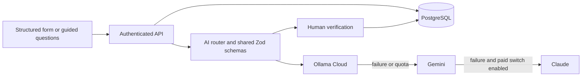

# AI implementation and live setup

> Chatbot update (31 October 2026): the new report assistant adds private tables and a queue. Follow [CHATBOT_SETUP.md](CHATBOT_SETUP.md) for its required additive migration and deployment. The existing-feature description below predates that delivery.

Updated 29 October 2026. This document describes the current implementation; the original architecture plan records
the earlier prototype scope.

## Working architecture

The browser is a static Next.js export on Cloudflare Pages. It calls the authenticated API using bearer sessions.
The same API source runs in Node locally and is bundled into `supabase/functions/api/index.ts` for Supabase. Prisma
and PostgreSQL store the normalized report, private document bytes, extraction decisions, provenance and audit events.
All AI requests happen in the API. Provider keys stay on the backend.



## Implemented workflows

| Feature                 | Behavior and durable records                                                                                                                                                                                                                                                                                                                                                             |
| ----------------------- | ---------------------------------------------------------------------------------------------------------------------------------------------------------------------------------------------------------------------------------------------------------------------------------------------------------------------------------------------------------------------------------------- |
| Guided reporting        | Fourteen fixed question groups, two to four questions per group, mapped to existing PvPI fields. Answers use the same form validation, unknown flags, partial dates, autosave and submission path as structured reporting. Mode changes retain answers. The last visited group is saved in audit history.                                                                                |
| Guided AI follow-ups    | AI selects up to three permitted group IDs for missing, contradictory or potentially serious information. It cannot create questions or write answers. If AI fails, the next unanswered groups come from fixed rules.                                                                                                                                                                    |
| Document extraction     | JPG, PNG and PDF uploads; patient initials, demographics, reaction details, history, investigations and medication fields from prescriptions, lab reports, discharge summaries and notes. Source text and uncertain readings are shown. The reporter chooses suspected/concomitant placement and each accepted field. Duration never invents a stop date.                                |
| Extraction verification | Pending runs survive reload. The reporter can resume, edit, confirm uncertain readings, mark dates approximate, apply or discard. Applying checks the current report version, rejects duplicate item IDs and serializes simultaneous requests. Accepted/edited/rejected items and document provenance are stored. Investigation sources appear in review.                                |
| Narrative drafting      | Rough notes plus optional saved report produce an editable suggestion. Source text, current narrative changes and unmatched numeric tokens are available for comparison. Human verification is required. Append/replace saves clinical text and the complete audit record in one transaction. Overlong text is rejected without truncation. Pending drafts can be reopened or discarded. |
| Consistency checks      | Reads saved report fields and available extraction facts, with pending/verified/uncertain labels; rejected readings are excluded. The latest reading per document is used within a bounded context. Findings are suggestions, with evidence and a link to the relevant form section.                                                                                                     |
| Finding decisions       | Corrected, keep with explanation, or unsure. Decisions survive reload and appear on the submission, case and reviewer pages. A check is marked as old after report edits. Nothing automatically changes a clinical field or blocks urgent escalation.                                                                                                                                    |
| Provider resilience     | Ollama first, Gemini second. Unsupported document types, failures, quota errors, malformed JSON and timeouts move to the next eligible provider. Every reply is schema-validated. A shared deadline reserves time for later providers. Provider/model and failed attempts are recorded.                                                                                                  |
| Paid usage control      | `src/server/ai/config.ts` contains `export const ALLOW_PAID_AI: boolean = false;`. Claude is filtered from configuration and runtime routing and guarded in its adapter. Keys and environment ordering cannot override the flag. Enabled paid providers always follow preferred providers.                                                                                               |

No new database tables or migrations are required: assistance history is reconstructed from the existing append-only
audit log; extraction runs/items and field provenance use the existing models. Report saves and extraction/narrative
application lock the parent case before reading its version and rows, preventing concurrent overwrites.

## Provider configuration

Copy `.env.example` to `.env` for local development and configure your database. Add these backend secrets locally or
in Supabase Edge Functions → Secrets:

```dotenv
AI_PROVIDER=auto
OLLAMA_API_KEY=
OLLAMA_MODEL=gemma4:31b
GEMINI_API_KEY=
GEMINI_MODEL=gemini-3.8-flash,gemini-3.5-flash-lite
```

At least one provider key is required for live AI. Configure Gemini to support PDF extraction: Ollama accepts images
in this application. A custom `OLLAMA_BASE_URL` can point at a reachable local Ollama server instead of Cloud. An Edge
Function cannot reach a server on your PC through `localhost`.

To allow paid Claude, change the boolean to `true`, add `ANTHROPIC_API_KEY`, optionally set `ANTHROPIC_MODEL`, then
rebuild and redeploy the API. Its default is `claude-sonnet-5-5`. There is no automatic paid opt-in.

The preferred providers have account-dependent quotas and billing. Use accounts without paid billing if free-only
usage is required. Exhausted quota produces fallback or an actionable failure; the app cannot change account billing.
See [Gemini pricing](https://ai.google.dev/gemini-api/docs/pricing) and [Ollama plans](https://ollama.com/pricing).

Ollama Cloud does not support constrained structured output, so the adapter supplies the JSON schema in the prompt
and validates the response locally. Local Ollama uses its schema parameter. See the
[official structured-output documentation](https://docs.ollama.com/capabilities/structured-outputs).

## Verification and deployment

```bash
npm ci
npm run test:db:init          # uses TEST_DATABASE_URL; never the development database
npm test
npm run lint
npm run typecheck
npm run test:e2e              # static site + local API + fictional fixture responses
npm run ai:check              # all four AI tasks against configured providers; no database needed
npm run build:api             # regenerate the deployable Supabase function
npm run build                # regenerate the Cloudflare static site
```

`AI_PROVIDER=fixture` exercises saved responses for all four tasks without a key. Fixture success verifies application
plumbing, not a live provider's availability or extraction quality. The included integration tests also cover lab
results and discharge-summary values, uncertainty, stale previews, simultaneous edits/applications, private access,
durable narrative and finding decisions. The browser test covers mode switching and restoration after reload.

Deploy the generated API and static site together. Existing Supabase projects need no new migration for this AI
update. Existing database configuration can remain in Supabase; the local API needs `DATABASE_URL` separately.

## Remaining inputs for live completion

Local verification completed: 90 unit/PostgreSQL tests and all 12 browser scenarios passed, including the extractor
source-verification and patient-mismatch controls. Lint, TypeScript, formatting, the production static build and the generated
API build passed. All four smoke-check tasks passed with `AI_PROVIDER=fixture`. Live Ollama Cloud checks have now passed for all four tasks. The updated Supabase
function still needs deployment; PDF extraction awaits a Gemini key. Browser checks used an existing Chromium executable
through `TEST_BROWSER_EXECUTABLE`; normal setup can use `npx playwright install chromium`.

1. An Ollama Cloud API key and a Gemini API key, added to backend secrets. One key can run the supported tasks;
   both provide fallback, and Gemini enables PDFs while Claude is disabled.
2. Access to the existing Supabase project and Cloudflare Pages deployment to publish the prepared files, or have
   the project owner deploy them using the README steps. Supply a local database URL only if local operation is wanted.
3. An Anthropic key only if paid Claude is wanted later; keep the code flag false otherwise.
4. Run the live smoke check and review extraction on the fictional samples with those accounts. The question bank's
   field mappings are validated in tests; clinical acceptance of wording and AI quality requires human review.

Keep keys in `.env` or the provider-secret screens. They are not needed in browser configuration or source files.

## Extractor accuracy checks

Live Ollama Cloud verification on 29 October 2026: `gemma4:31b` passed all 24 checked expectations for the clean
prescription and all 22 for the scanned prescription, with no additional evidence warnings on either response. The
PDF benchmark cases remain uncovered until a PDF-capable provider is configured. This is a limited sample result,
not a guarantee of accuracy on other documents. The Ollama key is configured in private backend environment files.

Extraction is deliberately conservative. It does not treat an issue date as a start date, calculate a stop date from
duration, replace a prescribed unit count with medicine strength, infer a generic drug or route, or treat “improved”
as a resolution date. The saved prescription fixture now preserves `1 cap` and `1 tab`, with unrecorded start dates null.

`extraction-quality.ts` checks source quotes for unsupported numbers/units, date components and meanings, ambiguous
numeric dates, missing evidence, inferred identifiers/names/routes, age/weight units and possible duplicate rows.
Questionable values are marked uncertain and remain unselected. Explicit approximate wording retains the approximate
date indicator. Unreadable replies are rejected and the next eligible provider is tried. Source page numbers are shown
when supplied. Applying values requires source verification; different patient initials require a separate confirmation.

The live benchmark is in `samples/extraction-benchmark.json`. Its prescription expectations were transcribed from the
actual clean and scanned images (these are different patients and different medicines). PDF expectations come from the
generated fictional lab and discharge documents. The benchmark checks both expected values and important null fields.

```bash
npm run ai:evaluate                     # configured provider chain, all four documents
npm run ai:evaluate -- --provider=gemini # test Gemini separately
npm run ai:evaluate -- --provider=ollama # image coverage only; PDFs report NOT COVERED
```

Results and individual failures are saved under `test-results/extractor-benchmark/`. This command requires live keys
and refuses fixture mode. Passing the supplied expectations is evidence about these samples; it does not establish
perfect extraction on arbitrary documents. Source quotes and page references are model-produced and still require
comparison with the original. The image benchmark has now passed with live Ollama credentials as recorded above. PDF coverage is still pending.

## Practical limits

Narrative numeric/date checks are heuristics and do not prove semantic correctness; matching numbers can still be
attached to the wrong medicine or event. Human verification remains necessary. Consistency checking uses recorded
extraction facts rather than independently reading every uploaded file, so unextracted documents must first be read
with AI. The AI performs no causality assessment, treatment decisions, signatures, official identifiers or external
submission. Fixed completeness rules and institutional review still govern the report workflow.
